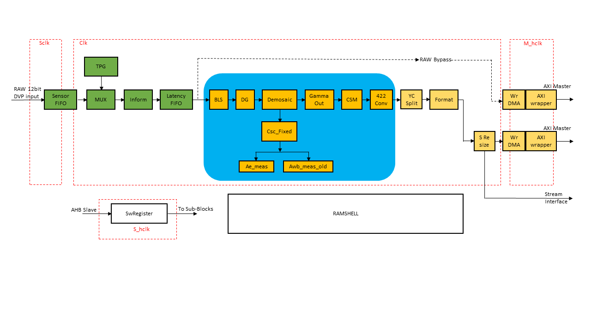

# ISPYocto

ISPYocto is a member of VeriSilicon ISP IP based on the ISP8000 family
customized for Open Se Cura.

## ISP Blocks

See [ISP blocks](docs/isp_blocks.md)

## ISP Register Map

See [ISP register map](docs/isp_regs.md)
